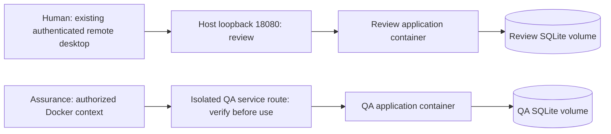

# Delivery Lab architecture — static baseline

One Python/FastAPI process with Uvicorn serves same-origin plain HTML/CSS/JavaScript and JSON endpoints. One application container per isolated QA/review instance. SQLite lives in a dedicated named volume. No frontend build framework, external CDN, business integration or background queue. Target host is `buc01w01ai01`, selected existing Docker engine; observed platform Linux x86-64 (`linux/amd64` image target). This is a proposed implementation contract, not deployed infrastructure.

Review and QA share no writable data, volume or Docker network. QA C0 never serves the human review port. Review promotion uses exactly the independently passing C1 image, not a new rebuild. Only Engineer acts as packaging/deployment/rollback operator in separately authorized app work; Assurance has independent Docker test access. CEO coordinates release and administrator actions without a Docker socket.

## Application and storage decisions

The [API contract](api.md) defines all endpoints and public errors. Database writes use a bound-parameter transaction. Commit completes before 201. Recommend SQLite WAL mode with synchronous=FULL, one application worker, 5s busy timeout, a persistent `/data/items.sqlite3` file, and schema version 1. Store UTC timestamps in the fixed sortable format and order by time then ID explicitly. The actual SQLite library version is captured from the resolved Python image at build time. Seed exactly once according to the API initialization marker. Health is process liveness; readiness verifies initialization/schema plus storage read/write ability without persistent probe rows. Log only timestamp, request identifier, method/route/status/duration and non-secret build identity; omit request bodies, item names and credentials.

Immutable build-time source commit/build ID must match the image labels and `/api/version`. Runtime environment cannot override source identity. Proposed configuration names: `DELIVERY_LAB_ENV=qa|review`, `DELIVERY_LAB_DB_PATH=/data/items.sqlite3`, `DELIVERY_LAB_PORT=8000`, `DELIVERY_LAB_LOG_LEVEL=info`; invalid environment/path fails startup/readiness. Bind service to `0.0.0.0:8000` inside its own network namespace, publish only host `127.0.0.1` on 18081 QA or 18080 review. One Uvicorn worker, no development reload. Keep runtime configuration exact and checksum the rendered Compose configuration.

Container must run as dedicated non-root UID/GID (proposed 10001:10001); initialization must establish that identity's access to the pilot volume without touching host/unrelated paths. Read-only root filesystem with a small tmpfs for `/tmp`; only `/data` writable persistently. No privileged mode, host network/PID namespace, Docker socket, host credentials or arbitrary bind mounts. Drop capabilities, use no-new-privileges and a bounded resource/log policy in the app package. Proposed limits: 1 CPU, 256MiB RAM, 128 PIDs, JSON log rotation 10MiB × 3; verify suitability in QA, not as a performance/SLA claim. Restart policy `unless-stopped` makes service independent of agent/desktop sessions; deliberate stops stay stopped.

Serve only local static assets; browser calls only same-origin API. Reject cross-origin browser creates and use JSON-only input (no form/text/plain create). No CORS allowance. Default allowed Host values for published use are 127.0.0.1 and localhost with the declared ports; the separately verified internal QA route may add its single pilot service name. Do not reflect arbitrary origins. UI renders text nodes; [UI reference](ui-reference.md) governs pending/uncertain request handling.

## Build inputs and open selections

Baseline permits explicitly unresolved exact selections; none of the following is an approved floating production input. Public documentation was inspected on 2026-11-17. Direct shell retrieval of package metadata was denied by the configured network proxy (403); no proxy change was attempted. Registry resolution and dependency resolution were not performed. Browser documentation does not establish an artifact digest, a compatible lock or a security assessment.

| Input | Recommended family / exact selection status | Required resolution and release consequence | Primary source |
|---|---|---|---|
| CPython / OS image | Official CPython 3.13 slim Debian Bookworm family. Exact patch tag, image index digest and linux/amd64 manifest digest **UNRESOLVED**. | Engineer selects a supported patch with compatible dependencies, records tag, registry retrieval time, index and platform digest/config, and pins FROM by digest before app build. No build reproducibility claim or deploy before this closes. | [Official Python image](https://hub.docker.com/_/python), [digest pinning guidance](https://docs.docker.com/build/building/best-practices/) |
| FastAPI | Plain FastAPI without optional standard extras; exact version **UNRESOLVED**. | Engineer selects and pins exact compatible version with source metadata and archive hashes in hashed lock before build. | [Version guidance](https://fastapi.tiangolo.com/deployment/versions/), [maintainer package](https://pypi.org/project/fastapi/) |
| Uvicorn | Minimal Uvicorn without standard extras; exact version **UNRESOLVED**. | Engineer pins exact version and complete compatible dependencies before build. | [Maintainer package](https://pypi.org/project/uvicorn/) |
| Transitive Python dependencies | Complete resolved set **UNRESOLVED** (including framework validation/web dependencies and server dependencies). | Resolve on target Python/platform; pin every package and wheel/sdist SHA-256; capture resolver/installer version and lock command. No unconstrained dependency installation. Formal acceptance suite remains independently owned. | [FastAPI dependency/version guidance](https://fastapi.tiangolo.com/deployment/versions/) |
| SQLite | Bundled CPython sqlite3 library; exact version **UNRESOLVED** until image selected. | Record sqlite3 library version and verify WAL, backup and transaction assumptions in the target image before runtime examination. | [SQLite backup documentation](https://www.sqlite.org/backup.html) |
| Build/CI actions and tools | Exact BuildKit/buildx, Compose, installer/resolver and GitHub Action commit SHAs **UNRESOLVED**. | Record tool identities; pin actions by full reviewed SHA, including checkout and artifact publication; administrator publishes only through authorized route. CI release gate remains open. | [GitHub action hardening guidance](https://docs.github.com/en/actions/security-for-github-actions/security-guides/security-hardening-for-github-actions) |

Do not invent a digest, reuse a mutable tag as proof, or substitute an image ID/config hash for an OCI manifest digest. Distinguish base-image index digest, base platform-manifest digest, application manifest digest and archive SHA-256. The source commit cannot be embedded self-referentially in its own Git manifest: the app image is built from an already published commit, while external deployment evidence binds that commit to the resulting image/config/archive.

These unresolved selections do not block static BASE.R/BASE.V or human baseline approval under the assignment. They block T2/runtime readiness. Resolution must be published as a new immutable technical input, with affected independent examination and preserved prior reports. A future supported version change is a new selection, not an implicit baseline update.

## Source and operational isolation

Only `pilot/delivery-lab/docs/` changes in this assignment. F2 remains at the exact external commit linked in [acceptance](acceptance.md); it is not merged into this branch. No Dockerfile, app code, acceptance test code, Compose implementation or `.github` workflow is created here. [Runbook](runbook.md) identifies allowlisted future pilot resources and CI/operator handoff requirements. Baseline manifest contains documentation file digests, provenance, open gates and explicit N/A runtime identities.
